# Entity-relationship diagram (Milestone 1)

Source: `docs/requirements/plan.md` "Data model". Amounts are integer minor units (USD cents); all times are stored in UTC.
`payments` and `refunds` are described "per contract" (plan data model and the Wave 1 API contract); their schemas were not merged when this was written.

## Owners

| Collection(s) | Owner |
|---|---|
| users, sessions | Abdelrahman |
| countries, cities, airports, attractions, currencies, airlines, flights | Joudy |
| flight_bookings, hotel_reservations, notifications, room_nights (booking use) | Karim |
| hotels, rooms, room_nights (schema), reviews | Sandra |
| payments, refunds, exchange_rates, audit_logs | Ahmed |
| itineraries, activities | Sarah |
| budget_entries, transport_costs | Abdelrahman |
| posts, comments, likes, reports | Malak |

## Diagram

```mermaid
erDiagram
    USERS ||--o{ SESSIONS : has
    USERS ||--o{ FLIGHT_BOOKINGS : makes
    USERS ||--o{ HOTEL_RESERVATIONS : makes
    USERS ||--o{ NOTIFICATIONS : receives
    USERS ||--o{ ITINERARIES : owns
    USERS ||--o{ POSTS : authors
    USERS ||--o{ COMMENTS : writes
    USERS ||--o{ LIKES : gives
    USERS ||--o{ REPORTS : files
    USERS ||--o{ REVIEWS : writes
    USERS ||--o{ AUDIT_LOGS : "actor of"

    COUNTRIES ||--o{ CITIES : contains
    CITIES ||--o{ AIRPORTS : has
    CITIES ||--o{ ATTRACTIONS : has
    CITIES ||--o{ HOTELS : hosts
    COUNTRIES }o--o{ CURRENCIES : uses

    AIRLINES ||--o{ FLIGHTS : operates
    AIRPORTS ||--o{ FLIGHTS : "departs from"
    AIRPORTS ||--o{ FLIGHTS : "arrives at"
    FLIGHTS ||--o{ FLIGHT_BOOKINGS : "booked in segments"

    HOTELS ||--o{ ROOMS : contains
    ROOMS ||--o{ ROOM_NIGHTS : "occupied per night"
    HOTEL_RESERVATIONS ||--o{ ROOM_NIGHTS : "holds or books"
    HOTELS ||--o{ HOTEL_RESERVATIONS : receives
    HOTELS ||--o{ REVIEWS : "reviewed in"
    HOTEL_RESERVATIONS ||--o| REVIEWS : "reviewed once"

    FLIGHT_BOOKINGS ||--o{ PAYMENTS : "paid by"
    HOTEL_RESERVATIONS ||--o{ PAYMENTS : "paid by"
    PAYMENTS ||--o| REFUNDS : "refunded by"

    ITINERARIES ||--o{ ACTIVITIES : plans
    ITINERARIES ||--o{ BUDGET_ENTRIES : budgets
    ITINERARIES ||--o{ TRANSPORT_COSTS : budgets
    POSTS ||--o{ COMMENTS : has
    POSTS ||--o{ LIKES : has

    USERS {
        ObjectId _id PK
        string name
        string email UK
        string passwordHash
        string phone
        string preferredCurrency
        date termsAcceptedAt
        string role "USER|ADMIN|AIRLINE_MOD|HOTEL_MOD"
        string status "ACTIVE|SUSPENDED|DEACTIVATED"
        boolean mustChangePassword
        int failedLoginCount
        date lockedUntil
        object assignedProvider "embedded type,providerId"
    }
    SESSIONS {
        ObjectId _id PK
        ObjectId userId FK
        string refreshTokenHash
        date lastActivityAt
        date expiresAt "TTL index"
        date revokedAt
    }
    COUNTRIES {
        string _id PK "dataset key e.g. EG"
        string name
        string currencyCode
    }
    CITIES {
        string _id PK "dataset key e.g. cairo"
        string name
        string countryCode FK
    }
    AIRPORTS {
        string _id PK "dataset key e.g. CAI"
        string name
        string cityId FK
        string countryCode FK
        string timeZone "IANA zone"
    }
    ATTRACTIONS {
        string _id PK "dataset key e.g. att-1"
        string name
        string cityId FK
    }
    CURRENCIES {
        string _id PK "ISO 4217 code"
        string name
    }
    AIRLINES {
        ObjectId _id PK
        string name
        string code UK
        string logoUrl
        boolean active
        object extraBaggage "pricePerBag,maxBagsPerPassenger"
        array cancellationTiers "daysBefore,refundPercent"
    }
    FLIGHTS {
        ObjectId _id PK
        ObjectId airlineId FK
        string flightNumber
        string fromAirport FK
        string toAirport FK
        date departAtUtc
        date arriveAtUtc
        string departLocalDate
        string status "SCHEDULED|CANCELLED|DEPARTED"
        array cabins "class,seats,booked,held,priceMinor,freeBags,maxKgPerBag"
    }
    FLIGHT_BOOKINGS {
        ObjectId _id PK
        ObjectId userId FK
        string reference UK "sparse, set on confirm"
        array segments "flightId,cabinClass,unitPriceMinor"
        array passengers "fullName,dob,docNumber,type,extraBags"
        int totalMinor
        string status "PENDING_PAYMENT|CONFIRMED|COMPLETED|EXPIRED|CANCELLED"
        date holdExpiresAt
        object policySnapshot
        date policiesAcceptedAt
        ObjectId paymentId FK
        ObjectId refundId FK
    }
    HOTELS {
        ObjectId _id PK
        string name
        string address
        string cityId FK
        string countryCode FK
        string description
        array photos "max 5"
        int starClass
        array amenities
        string checkInTime
        string checkOutTime
        array cancellationTiers "daysBefore,refundPercent"
        boolean active
        number ratingAvg
        int ratingCount
    }
    ROOMS {
        ObjectId _id PK
        ObjectId hotelId FK
        string number "unique with hotelId"
        string type
        int beds
        int maxOccupancy
        int priceMinor
        array availability "from,to non-overlapping"
        boolean active
        boolean everReserved
    }
    ROOM_NIGHTS {
        ObjectId _id PK
        ObjectId roomId FK
        ObjectId hotelId FK
        string date "unique with roomId"
        string kind "BLOCKED|HELD|BOOKED"
        ObjectId reservationId FK
        string reference
        date expiresAt
    }
    HOTEL_RESERVATIONS {
        ObjectId _id PK
        ObjectId userId FK
        ObjectId hotelId FK
        string reference
        string checkIn
        string checkOut
        array rooms "roomId,adults,children ages,nightlyPriceMinor"
        int totalMinor
        string status "same lifecycle as flight bookings"
        date holdExpiresAt
        object policySnapshot
        date policiesAcceptedAt
        ObjectId paymentId FK
        ObjectId refundId FK
    }
    REVIEWS {
        ObjectId _id PK
        ObjectId hotelId FK
        ObjectId reservationId FK "unique"
        ObjectId userId FK
        int rating "1 to 5"
        string text "max 1000"
        boolean hidden
    }
    PAYMENTS {
        ObjectId _id PK
        string bookingType "FLIGHT|HOTEL"
        ObjectId bookingId FK
        string stripeId UK
        int amountMinor
        string currency
        string status "REQUIRES_PAYMENT|SUCCEEDED|FAILED|CANCELED"
    }
    REFUNDS {
        ObjectId _id PK
        string bookingType "FLIGHT|HOTEL"
        ObjectId bookingId FK
        string stripeId UK
        int amountMinor
        string currency
        string status "PENDING|REFUNDED|FAILED"
        int refundPercent
    }
    EXCHANGE_RATES {
        ObjectId _id PK
        string base
        string rateDate UK "YYYY-MM-DD from FX API"
        string fetchedDate
        object rates "code to number map"
    }
    ITINERARIES {
        ObjectId _id PK
        ObjectId ownerId FK
        string title "max 100"
        array countries
        date startDate
        string visibility "PRIVATE|PUBLIC"
        boolean hidden
        array days "_id,cityId,notes max 60"
        object clonedFrom "itineraryId,authorId,authorName"
    }
    ACTIVITIES {
        ObjectId _id PK
        ObjectId itineraryId FK
        ObjectId dayId "id of embedded day"
        string name
        string description
        string time
        int costMinor
        string currency
        array images "max 5"
    }
    BUDGET_ENTRIES {
        ObjectId _id PK
        ObjectId itineraryId FK
        ObjectId dayId
        string category "FOOD|ACCOMMODATION|IN_CITY_TRANSPORT|ACTIVITIES"
        int amountMinor
        string currency
    }
    TRANSPORT_COSTS {
        ObjectId _id PK
        ObjectId itineraryId FK
        ObjectId dayId
        string mode
        string fromCityId FK
        string toCityId FK
        int amountMinor
        string currency
    }
    POSTS {
        ObjectId _id PK
        ObjectId authorId FK
        string title
        string body
        array tags "max 5, 30 chars"
        array images "max 5"
        string status "DRAFT|PUBLISHED"
        boolean hidden
        int likeCount
        int commentCount
    }
    COMMENTS {
        ObjectId _id PK
        ObjectId postId FK
        ObjectId authorId FK
        string body "max 500"
    }
    LIKES {
        ObjectId _id PK
        ObjectId postId FK
        ObjectId userId FK "unique with postId"
    }
    REPORTS {
        ObjectId _id PK
        ObjectId reporterId FK
        string targetType "POST|COMMENT|REVIEW|ITINERARY"
        string targetId
        string reason
        string status "OPEN|DISMISSED|HIDDEN|DELETED"
        ObjectId resolvedBy FK
    }
    NOTIFICATIONS {
        ObjectId _id PK
        ObjectId userId FK
        string type
        string title
        string body
        string link
        date readAt
    }
    AUDIT_LOGS {
        ObjectId _id PK
        string actorId FK "null for system"
        string action
        string targetType
        string targetId
        object metadata
        date createdAt "append-only"
    }
```

## Notes

- Every collection has `timestamps: true` except `audit_logs` (`createdAt` only, immutable).
- `payments` and `refunds` reference a booking by `bookingType` plus `bookingId` (polymorphic), so the diagram shows both booking collections.
- Unique indexes enforce the race-sensitive rules: one like per user and post, one review per reservation, one report per item and reporter, and `room_nights (roomId, date)` against overlapping room bookings.
- `exchange_rates` keeps every snapshot; the latest is the fallback when the FX API fails.
