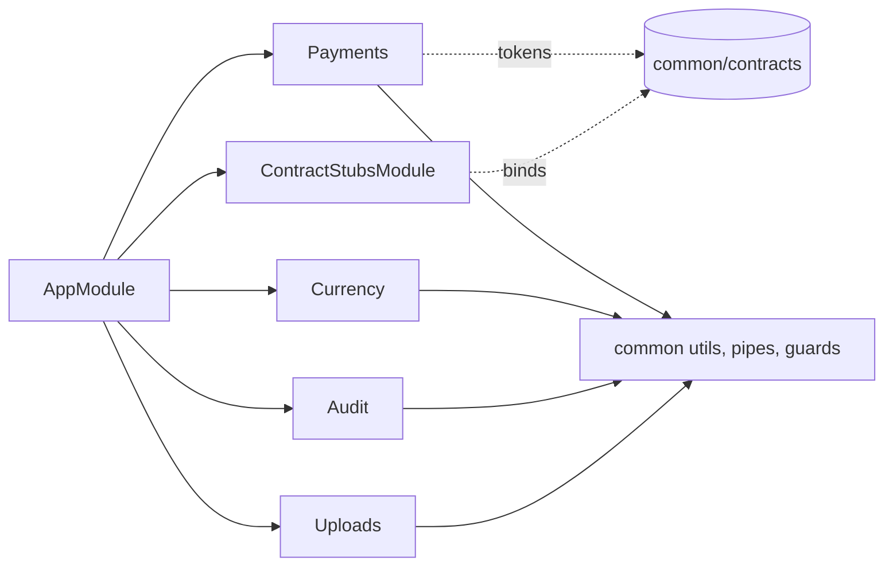

# Module map (backend)

`AppModule` (`backend/src/app.module.ts`) wires configuration, MongoDB, scheduling, the cross-cutting common layer and the feature modules. Feature modules never import each other: they talk through the contracts in `backend/src/common/contracts`, injected by token (`backend/src/common/contracts/tokens.ts`). Until the owning teammate's module lands, `ContractStubsModule` binds in-memory stubs to those tokens.

## Feature modules (Ahmed)

| Module | Path | Owns | Exposes | Depends on |
|---|---|---|---|---|
| Payments | `src/modules/payments/` | `payments`, `refunds` collections; Stripe PaymentIntents, webhook, retry, refunds, booking policies | HTTP: `/api/payments`, `/api/refunds/:id`, `/api/bookings/:type/:id/{policies,accept-policies}`. Tokens: `PAYMENTS_SERVICE`, `REFUNDS_SERVICE` | `PAYABLE_BOOKING`, `POLICIES_PROVIDER`, `NOTIFICATIONS_SERVICE` (contracts); `ConfigService` (`PLATFORM_CURRENCY`, Stripe keys) |
| Currency | `src/modules/currency/` | `exchange_rates` collection; daily FX refresh (cron) | HTTP: `/api/currencies`, `/api/currencies/rates`; `CurrencyService.convert` | `ConfigService` (FX API) |
| Audit | `src/modules/audit/` | `audit_logs` collection (append-only) | HTTP: `GET /api/admin/audit-logs` (admin); `AuditService.record` | none |
| Uploads | `src/modules/uploads/` | Image files on disk under `UPLOAD_DIR` | HTTP: `GET /api/uploads/:filename`; `UploadsService.saveImages` / `deleteImage` | `ConfigService` |

## Common layer

| Area | Path | Purpose |
|---|---|---|
| Contracts and tokens | `src/common/contracts/` | Interfaces shared between teammates' modules |
| Stubs | `src/common/stubs/` | Temporary in-memory implementations bound to contract tokens |
| Guards, decorators | `src/common/guards/`, `src/common/decorators/` | Deny-by-default guard (temporary dev auth), `@Public`, `@Roles`, `@CurrentUser` |
| Pipes, filters, dto | `src/common/{pipes,filters,dto}/` | Validation (whitelist), `ParseObjectIdPipe`, standard error body, fixed-size pagination |
| Security | `src/common/security/` | Password hasher |
| Swagger | `src/common/swagger/` | `ApiErrors` decorator and Swagger setup |
| Utils | `src/common/utils/` | Money (integer minor units, per-currency exponent) and dates |
| Config, bootstrap | `src/config/`, `src/bootstrap/` | Joi env validation, `setupApp` shared by `main.ts` and tests |

## Dependency direction

Teammates' modules (auth, flights, hotels, bookings, notifications, ...) replace the stubs by providing the same tokens; Payments and the others need no change.
